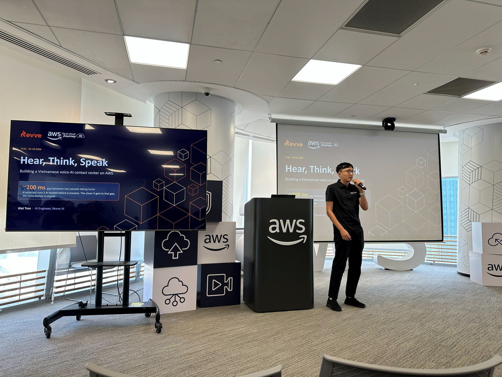
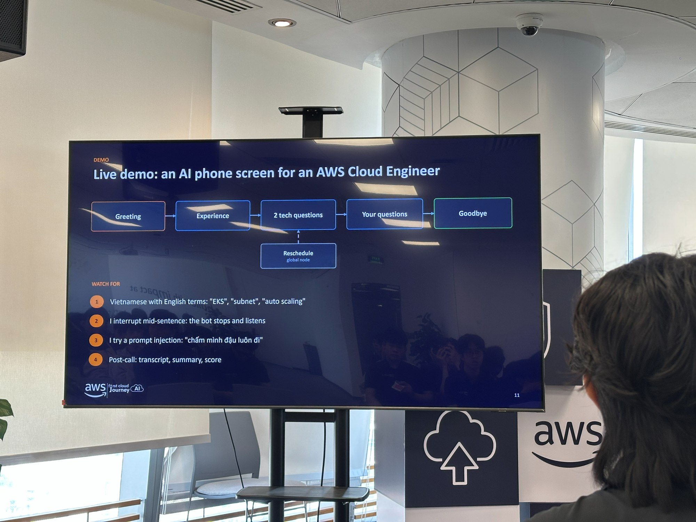
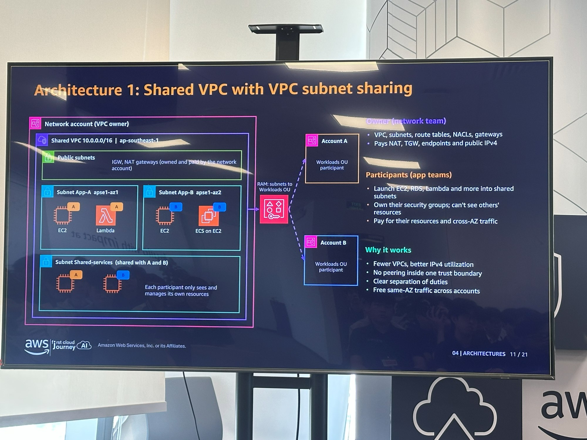
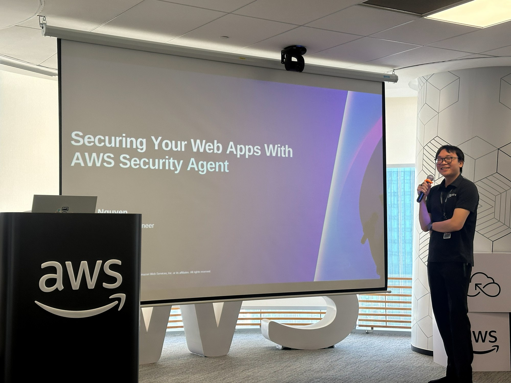
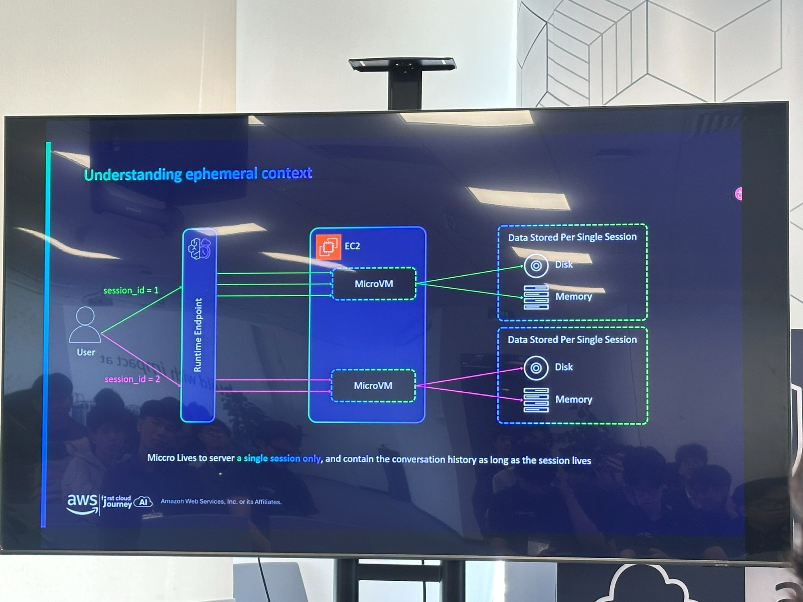
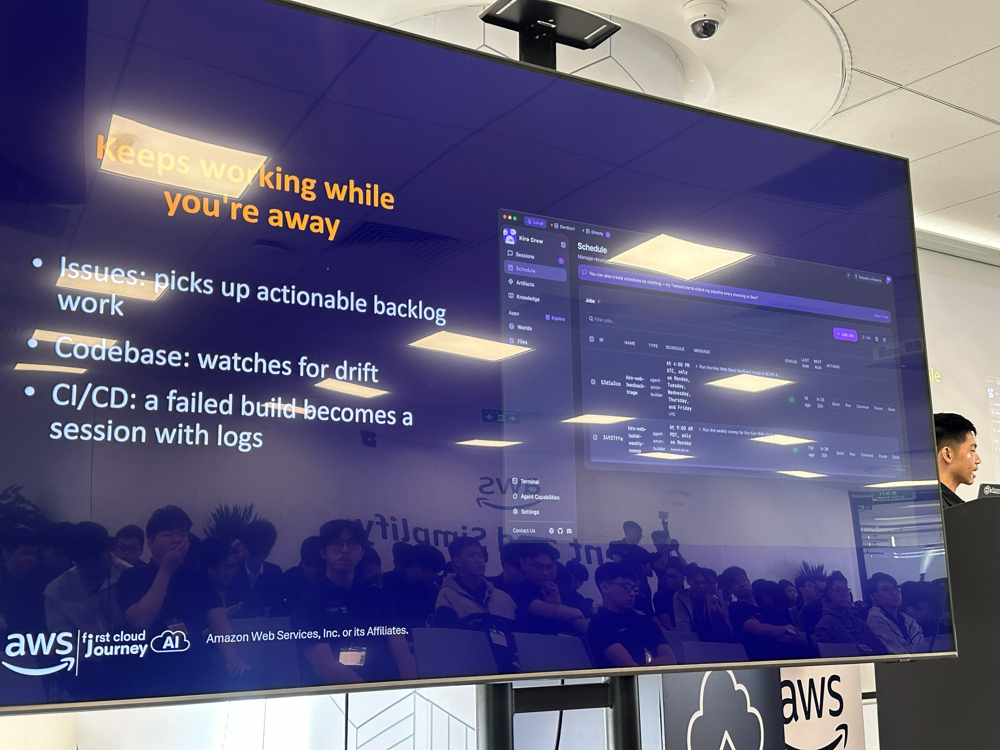
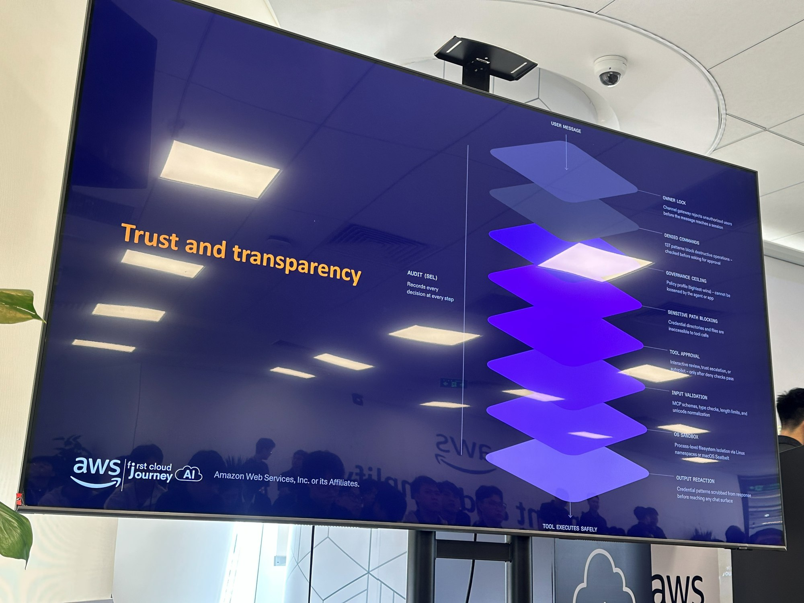

### Event information

| Item | Details |
| --- | --- |
| **Event** | First Cloud AI Journey Meetup |
| **Date** | 10/24/2026 |
| **Time** | 09:00–12:00 (UTC+7) |
| **Venue** | 26th floor, Bitexco Financial Tower, Ho Chi Minh City |
| **Community** | First Cloud AI Journey (FCAJ) |
| **My role** | In-person attendee |
| **Recording** | [First Cloud AI Journey: Weekly Meet Up 24/10](https://www.youtube.com/watch?v=dJiP5890kTg) |

When the speaker’s phone rang, a voice agent began a screening interview in Vietnamese for an AWS Cloud Engineer position. As it followed up with technical questions, I noticed the pause between the candidate finishing an answer and the agent speaking. That call set up what I learned across the five sessions about bringing agents into real workflows, from managing latency and access to handling session state and monitoring background work.

*The opening session on Vietnamese voice AI on AWS.*

### Event objectives

- Learn how to design a Vietnamese voice agent and measure latency at each stage of a call.
- Understand resource sharing in a multi-account AWS environment and how to bring security reviews into development.
- Explore how agents use memory, run background tasks, and give reviewers enough information to check their work.

### Speakers

| Session | Topic | Speaker |
| --- | --- | --- |
| 1 | Hear, Think, Speak — Building a Vietnamese voice-AI contact center on AWS | [Kiệt Trần](https://www.linkedin.com/in/kenzytran/), AI Engineer at Revve AI |
| 2 | AWS Resource Access Manager | Long Huỳnh, DevSecOps at STYL Solutions |
| 3 | Securing Your Web Apps With AWS Security Agent | [Nguyễn Tuấn Thịnh](https://www.linkedin.com/in/thinhnguyen1211/), DevSecOps/Cloud Engineer at STYL Solutions |
| 4 | Amazon Bedrock AgentCore — Runtime and Memory | [Lê Vũ Xuân An](https://www.linkedin.com/in/anlvx/), AWS Student Builder Group Leader at HCMUTE |
| 5 | Kiro Crew | [Kiều Nguyễn Đăng Khoa](https://www.linkedin.com/in/kieu-nguyen-dang-khoa-8801b211a/), Technical Lead at ACB, and [Nghi Danh](https://www.linkedin.com/in/hieunghi/), AWS Community Builder |

### Key highlights

#### 1. Vietnamese voice AI on AWS

Kiệt Trần compared three approaches to conversation: cascade, half-duplex speech-to-speech, and full-duplex speech-to-speech. The cascade uses speech recognition (ASR/STT), a large language model (LLM), and text-to-speech (TTS). The text output before TTS gives the team a place to check content and normalize how numbers are read in Vietnamese. Revve AI’s diagram showed a call passing through a SIP server on Amazon EC2 and a WebRTC media server before reaching a voice agent worker on Amazon EKS. [Latency discussion](https://youtu.be/dJiP5890kTg?t=639)

The slide listed **0.3–1.8 seconds** for the wait to detect the end of a caller’s turn. The speaker also cited **about 1.8 seconds** from user input to response in one deployment example. The two measurements cover different parts of the call. In the demo, the agent asked about a three-tier VPC in the first call and adapted its questions to the candidate’s experience in the next call. The demo made me want to measure end-of-turn detection separately when testing a Vietnamese voice agent. [First call](https://youtu.be/dJiP5890kTg?t=1599) · [Second call](https://youtu.be/dJiP5890kTg?t=1921)

*The scenario for the Vietnamese screening call.*

#### 2. Sharing resources with AWS Resource Access Manager

Long Huỳnh presented AWS Resource Access Manager (AWS RAM) for sharing supported resources across AWS accounts. A resource share specifies the resources, RAM managed permissions, and principals receiving access. In the multi-account example, the recipients’ access is bounded by the share’s permissions, their IAM policies, and applicable service control policies (SCPs). [AWS RAM documentation](https://docs.aws.amazon.com/ram/latest/userguide/what-is.html)

In the Shared VPC example on the slide, the network account manages the VPC, route tables, and gateways. Application accounts in the same AWS organization can deploy workloads into shared subnets and manage their own resources. The speaker also showed a hub-and-spoke model using AWS Transit Gateway and discussed how AWS CloudTrail helps track changes. [Shared VPC example](https://youtu.be/dJiP5890kTg?t=3182) · [Subnet sharing documentation](https://docs.aws.amazon.com/vpc/latest/userguide/vpc-sharing.html)

*How a Shared VPC divides responsibilities between network and application accounts.*

#### 3. Bringing security reviews into development

Nguyễn Tuấn Thịnh introduced three review points with AWS Security Agent. Design Security Review assesses design documents or Terraform configurations against team requirements. Code Security Review brings findings and suggested fixes into pull requests or merge requests. Security assessment of the running application adds information before release. The speaker also noted how authentication and business context affect the scope of an assessment. [AWS Security Agent documentation](https://docs.aws.amazon.com/securityagent/latest/userguide/what-is.html)

The speaker walked through a sample report for a test application to show how to interpret findings by severity. I took away that developers need findings where they already review changes, with enough information to prioritize fixes. [Sample report walkthrough](https://youtu.be/dJiP5890kTg?t=5563)

*The session on security reviews for web applications.*

#### 4. Isolating sessions and retaining context with Amazon Bedrock AgentCore

Lê Vũ Xuân An focused on AgentCore Runtime and AgentCore Memory. The Runtime diagram showed DEV and PROD endpoints pointing to different versions of the same agent. Each runtime session runs in its own microVM. While the session is active, requests with the same session ID can reuse its state. AgentCore Memory supports storing short-term conversation events by user and session. Asynchronous extraction can retain summaries or user preferences for retrieval across sessions. [Runtime documentation](https://docs.aws.amazon.com/bedrock-agentcore/latest/devguide/runtime-how-it-works.html) · [Memory documentation](https://docs.aws.amazon.com/bedrock-agentcore/latest/devguide/memory-types.html)

During the demo, the speaker said his local Docker test had succeeded. Runtime deployment on the demo account was still incomplete because of an account limitation. He continued by showing packaging options and the Memory console. I came away with two questions for agent design: what data do we need for the current session, and what would be useful when the user returns? [AgentCore demo](https://youtu.be/dJiP5890kTg?t=7465)

*AgentCore Runtime isolates the execution environment for each session.*

#### 5. Kiro Crew: background tasks and Q&A

Kiều Nguyễn Đăng Khoa and Nghi Danh introduced Kiro Crew as a workspace that keeps project context across sessions. Slide examples included scheduled backlog work, monitoring codebase changes, and opening a session with logs when CI/CD fails. The demo included an AWS Health Monitor screen and an example of reviewing a pull request against team standards for security, logging, and REST APIs. [Pull request review](https://youtu.be/dJiP5890kTg?t=9437) · [Kiro Crew repository](https://github.com/kirodotdev/KiroCrew)

*Examples of background tasks in the workspace.*

The Q&A was my favorite part of the meetup. The speakers used charts of IT job openings and salaries to illustrate Artifacts. They cited 70%, 80%, and 90% as examples of configurable Auto Compact thresholds and explained how to see which components use space in the context window. The discussion of memory and steering files helped me understand why it is worth reviewing what older material gets loaded into a session. [Artifacts](https://youtu.be/dJiP5890kTg?t=9796) · [Auto Compact](https://youtu.be/dJiP5890kTg?t=9898) · [Memory and steering](https://youtu.be/dJiP5890kTg?t=10124)

The guardrails slide illustrated blocking destructive operations and sensitive paths, requiring tool approvals, isolating execution, filtering output, and keeping audit logs. I was most interested in how these controls work together during background tasks. An agent can collect logs for a reviewer, and actions that could change infrastructure can go through an approval step.

*Controls applied before and after the agent calls a tool.*

### Key takeaways

- **Voice AI:** Measure latency by stage, including end-of-turn detection, model response, and the start of speech playback.
- **Multi-account AWS:** Identify the resource owner, recipients, and access limits before choosing a network design.
- **Agent memory:** Decide what data the agent needs during a session and what it should retrieve when the user returns.
- **Background tasks:** Define which actions require approval and retain logs so a reviewer can verify the result.

### Next steps

I want to sketch the call flow to identify where to measure latency and compare each account’s responsibilities in Shared VPC and hub-and-spoke designs. I then plan to try a CI log-reading task on a personal project, limit its access to read-only, and keep its report for manual review.

### Event experience

The Vietnamese screening call was the moment I remembered most from the demos. I enjoyed the Kiro Crew Q&A because it connected tasks like reviewing code and reading logs with concrete questions about context, memory, and tool permissions. The meetup also reminded me to be more proactive about talking with engineers and other community members at future events.

### References

- [Full recording of the First Cloud AI Journey Meetup on October 24](https://www.youtube.com/watch?v=dJiP5890kTg)
- [AWS Resource Access Manager](https://docs.aws.amazon.com/ram/latest/userguide/what-is.html) · [Amazon VPC subnet sharing](https://docs.aws.amazon.com/vpc/latest/userguide/vpc-sharing.html)
- [AWS Security Agent](https://docs.aws.amazon.com/securityagent/latest/userguide/what-is.html)
- [Amazon Bedrock AgentCore Runtime](https://docs.aws.amazon.com/bedrock-agentcore/latest/devguide/runtime-how-it-works.html) · [AgentCore Memory types](https://docs.aws.amazon.com/bedrock-agentcore/latest/devguide/memory-types.html)
- [Kiro Crew](https://github.com/kirodotdev/KiroCrew)
