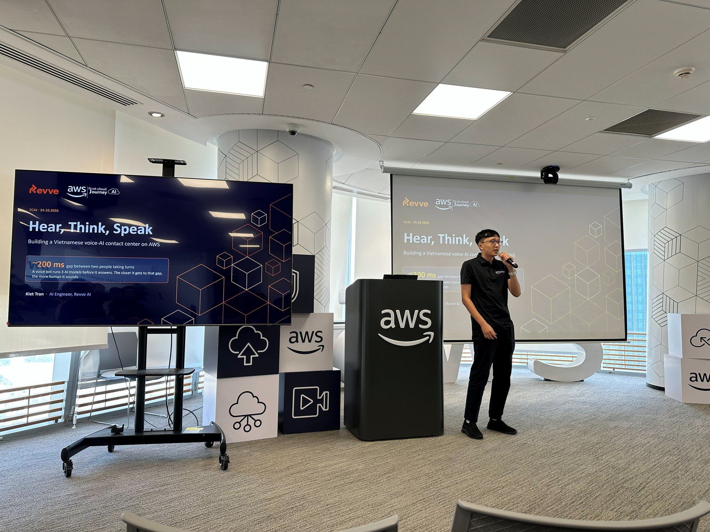
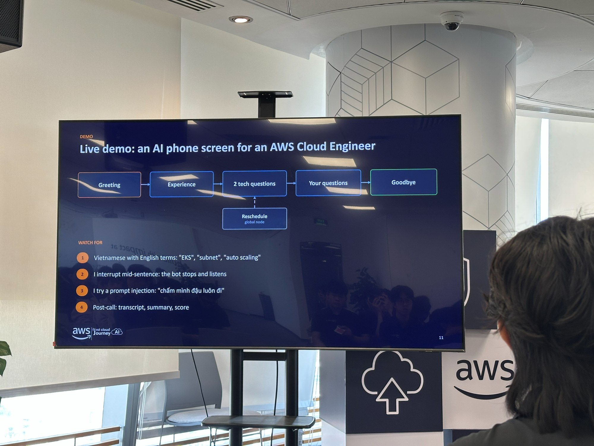
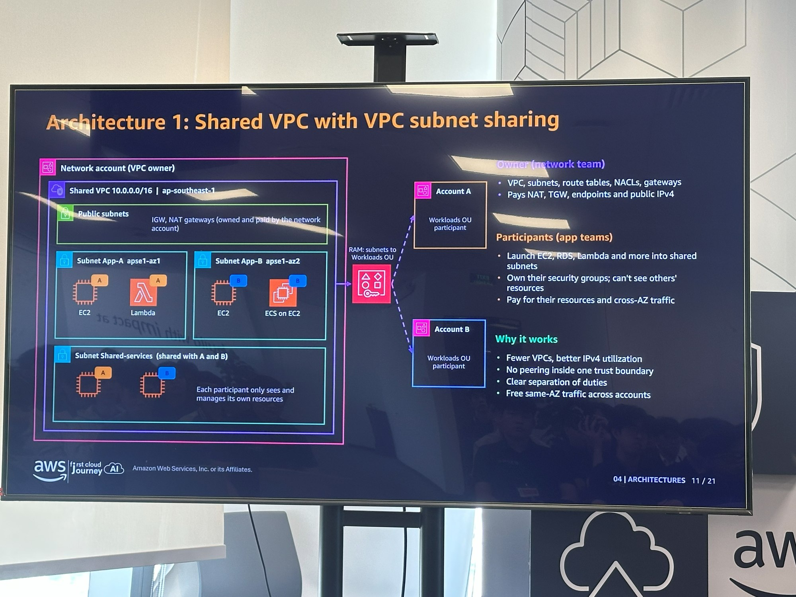
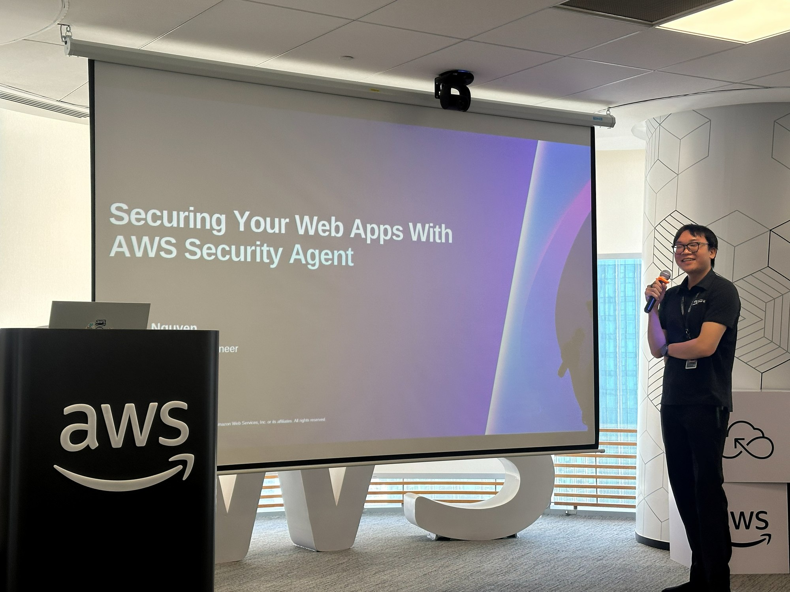
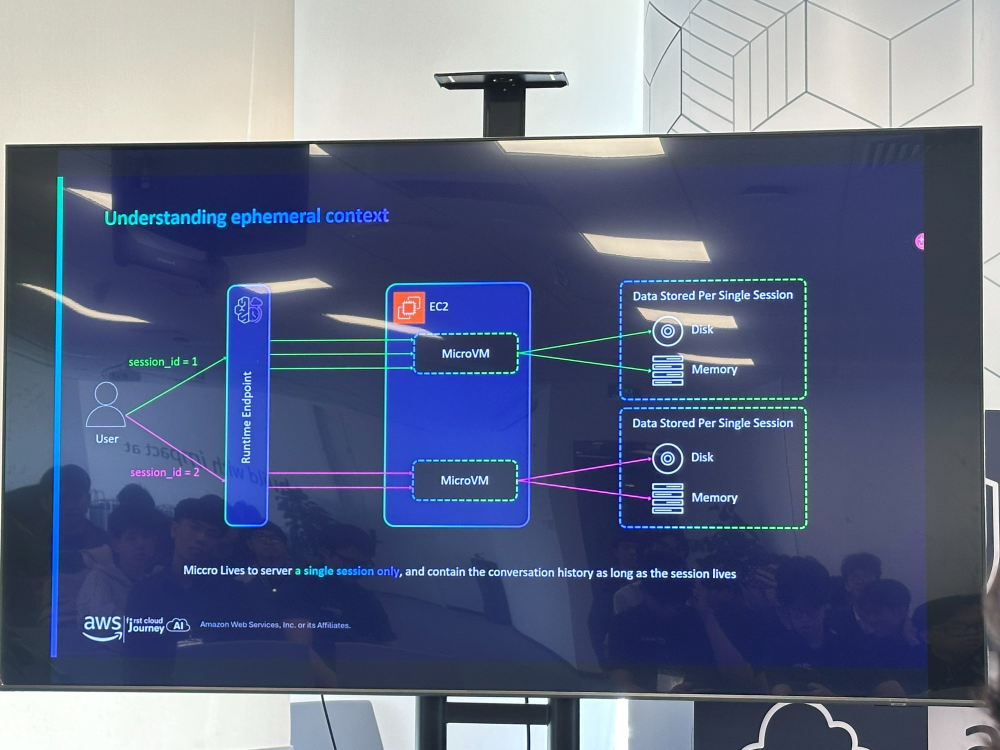
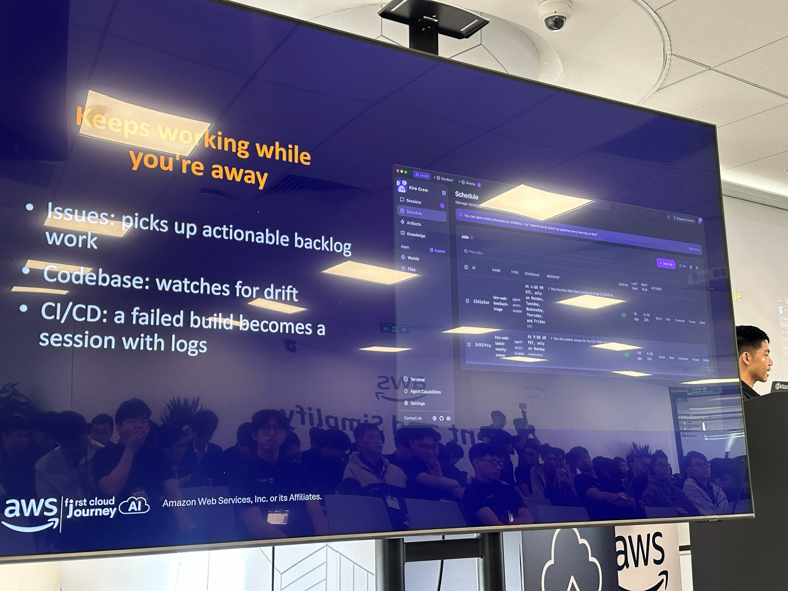
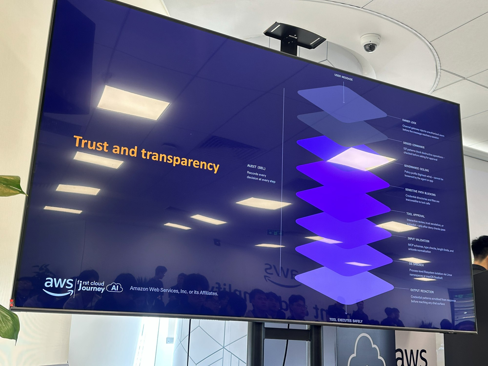

### Thông tin sự kiện

| Nội dung | Chi tiết |
| --- | --- |
| **Tên sự kiện** | First Cloud AI Journey Meetup |
| **Ngày** | 24/10/2026 |
| **Thời gian** | 09:00–12:00 (UTC+7) |
| **Địa điểm** | Tầng 26, Bitexco Financial Tower, TP.HCM |
| **Cộng đồng** | First Cloud AI Journey (FCAJ) |
| **Vai trò** | Người tham dự trực tiếp |
| **Bản ghi** | [First Cloud AI Journey: Weekly Meet Up 24/10](https://www.youtube.com/watch?v=dJiP5890kTg) |

Khi điện thoại của diễn giả đổ chuông, một voice agent bắt đầu cuộc phỏng vấn sơ tuyển bằng tiếng Việt cho vị trí AWS Cloud Engineer. Nghe agent tiếp lời và đặt câu hỏi kỹ thuật, tôi chú ý đến khoảng dừng giữa lúc ứng viên trả lời xong và lúc agent lên tiếng. Từ cuộc gọi đó, năm phiên của meetup giúp tôi hình dung những yêu cầu khi đưa agent vào quy trình thực tế, từ độ trễ và quyền truy cập đến trạng thái phiên và cách theo dõi tác vụ chạy nền.

*Phiên mở đầu về hệ thống Voice AI tiếng Việt trên AWS.*

### Mục tiêu tham gia

- Tìm hiểu cách thiết kế voice agent tiếng Việt và đo độ trễ theo từng khâu của cuộc gọi.
- Hiểu cách chia sẻ tài nguyên trong môi trường AWS đa tài khoản và đưa đánh giá bảo mật vào quy trình phát triển.
- Tìm hiểu cách vận hành agent có bộ nhớ, chạy tác vụ nền và để lại thông tin cho người duyệt.

### Diễn giả

| Phiên | Chủ đề | Diễn giả |
| --- | --- | --- |
| 1 | Hear, Think, Speak — Building a Vietnamese voice-AI contact center on AWS | [Kiệt Trần](https://www.linkedin.com/in/kenzytran/), AI Engineer tại Revve AI |
| 2 | AWS Resource Access Manager | Long Huỳnh, DevSecOps tại STYL Solutions |
| 3 | Securing Your Web Apps With AWS Security Agent | [Nguyễn Tuấn Thịnh](https://www.linkedin.com/in/thinhnguyen1211/), DevSecOps/Cloud Engineer tại STYL Solutions |
| 4 | Amazon Bedrock AgentCore — Runtime và Memory | [Lê Vũ Xuân An](https://www.linkedin.com/in/anlvx/), AWS Student Builder Group Leader tại HCMUTE |
| 5 | Kiro Crew | [Kiều Nguyễn Đăng Khoa](https://www.linkedin.com/in/kieu-nguyen-dang-khoa-8801b211a/), Technical Lead tại ACB, và [Nghi Danh](https://www.linkedin.com/in/hieunghi/), AWS Community Builder |

### Nội dung nổi bật

#### 1. Voice AI tiếng Việt trên AWS

Kiệt Trần so sánh ba cách xử lý hội thoại gồm cascade, speech-to-speech bán song công và speech-to-speech song công toàn phần. Kiến trúc cascade đi qua nhận dạng giọng nói (ASR/STT), mô hình ngôn ngữ (LLM) và tổng hợp giọng nói (TTS). Đầu ra văn bản trước TTS tạo một điểm để kiểm tra nội dung và chuẩn hóa cách đọc số tiếng Việt. Sơ đồ của Revve AI cho thấy cuộc gọi đi qua SIP server trên Amazon EC2 và media server dùng WebRTC tới voice agent worker trên Amazon EKS. [Phần trình bày về độ trễ](https://youtu.be/dJiP5890kTg?t=639)

Slide ghi **0,3–1,8 giây** cho thời gian chờ xác định người gọi đã nói xong. Diễn giả cũng nêu **khoảng 1,8 giây** từ đầu vào của người dùng đến phản hồi trong một ví dụ triển khai. Hai số đo mô tả hai phạm vi khác nhau trong cuộc gọi. Trong demo, agent hỏi ứng viên về VPC ba tầng ở lượt gọi đầu và điều chỉnh câu hỏi theo kinh nghiệm của ứng viên ở lượt tiếp theo. Ví dụ này khiến tôi muốn đo riêng thời gian nhận biết hết lượt nói khi thử nghiệm voice agent tiếng Việt. [Lượt gọi đầu](https://youtu.be/dJiP5890kTg?t=1599) · [Lượt gọi tiếp theo](https://youtu.be/dJiP5890kTg?t=1921)

*Kịch bản demo cuộc gọi sơ tuyển bằng tiếng Việt.*

#### 2. Chia sẻ tài nguyên với AWS Resource Access Manager

Long Huỳnh trình bày cách dùng AWS Resource Access Manager (AWS RAM) để chia sẻ tài nguyên được hỗ trợ giữa các tài khoản AWS. Một resource share xác định tài nguyên, RAM managed permissions và bên nhận chia sẻ. Trong ví dụ đa tài khoản, quyền của bên nhận chịu giới hạn bởi quyền chia sẻ, chính sách IAM và Service Control Policies (SCP) áp dụng. [Tài liệu AWS RAM](https://docs.aws.amazon.com/ram/latest/userguide/what-is.html)

Trong ví dụ Shared VPC trên slide, tài khoản mạng giữ quyền quản lý VPC, bảng định tuyến và gateway. Các tài khoản ứng dụng cùng AWS Organizations có thể triển khai workload vào subnet được chia sẻ và quản lý tài nguyên của mình. Diễn giả cũng đưa ra mô hình hub-and-spoke dùng AWS Transit Gateway và đề cập vai trò của AWS CloudTrail khi cần truy vết thay đổi. [Ví dụ Shared VPC](https://youtu.be/dJiP5890kTg?t=3182) · [Tài liệu chia sẻ subnet](https://docs.aws.amazon.com/vpc/latest/userguide/vpc-sharing.html)

*Sơ đồ phân chia trách nhiệm giữa tài khoản mạng và các tài khoản ứng dụng.*

#### 3. Đưa đánh giá bảo mật vào vòng đời phát triển

Nguyễn Tuấn Thịnh giới thiệu ba điểm đánh giá với AWS Security Agent. Design Security Review rà soát tài liệu thiết kế hoặc cấu hình Terraform theo yêu cầu của đội. Code Security Review đưa phát hiện và gợi ý sửa vào luồng duyệt pull request hoặc merge request. Đánh giá bảo mật ứng dụng đang chạy bổ sung thông tin trước khi phát hành. Diễn giả cũng lưu ý rằng xác thực và ngữ cảnh nghiệp vụ ảnh hưởng đến phạm vi đánh giá. [Tài liệu AWS Security Agent](https://docs.aws.amazon.com/securityagent/latest/userguide/what-is.html)

Trong phần trình bày báo cáo mẫu trên ứng dụng thử nghiệm, diễn giả minh họa cách đọc phát hiện theo mức độ nghiêm trọng. Điều tôi rút ra là đội phát triển cần nhìn thấy phát hiện ở nơi họ duyệt thay đổi và có đủ thông tin để ưu tiên khắc phục. [Phần báo cáo mẫu](https://youtu.be/dJiP5890kTg?t=5563)

*Phiên chia sẻ về đánh giá bảo mật ứng dụng web.*

#### 4. Cách ly phiên và lưu ngữ cảnh với Amazon Bedrock AgentCore

Lê Vũ Xuân An tập trung vào AgentCore Runtime và AgentCore Memory. Sơ đồ Runtime minh họa hai endpoint DEV và PROD trỏ tới các phiên bản khác nhau của cùng một agent. Mỗi runtime session chạy trong một microVM riêng. Trong vòng đời phiên, các yêu cầu cùng session ID có thể dùng lại trạng thái của phiên đó. AgentCore Memory hỗ trợ lưu sự kiện hội thoại ngắn hạn theo người dùng và phiên. Cơ chế trích xuất bất đồng bộ có thể lưu tóm tắt hoặc tùy chọn người dùng để truy xuất qua nhiều phiên. [Tài liệu Runtime](https://docs.aws.amazon.com/bedrock-agentcore/latest/devguide/runtime-how-it-works.html) · [Tài liệu Memory](https://docs.aws.amazon.com/bedrock-agentcore/latest/devguide/memory-types.html)

Trong phần demo, diễn giả cho biết đã kiểm thử Docker thành công trên máy cá nhân. Việc triển khai Runtime trên tài khoản trình diễn còn dang dở do giới hạn tài khoản. Anh tiếp tục giới thiệu các lựa chọn đóng gói và giao diện Memory. Tôi rút ra hai câu hỏi cần trả lời khi thiết kế agent: dữ liệu nào chỉ cần trong phiên hiện tại, và dữ liệu nào có giá trị khi người dùng quay lại? [Phần demo AgentCore](https://youtu.be/dJiP5890kTg?t=7465)

*AgentCore Runtime cách ly môi trường thực thi theo phiên.*

#### 5. Kiro Crew: tác vụ chạy nền và hỏi đáp

Kiều Nguyễn Đăng Khoa và Nghi Danh giới thiệu Kiro Crew như một workspace giữ ngữ cảnh dự án qua nhiều phiên. Các ví dụ trên slide gồm xử lý backlog theo lịch, theo dõi thay đổi trong codebase và mở phiên có log khi CI/CD gặp lỗi. Phần trình diễn có màn hình AWS Health Monitor và ví dụ hỗ trợ review pull request theo chuẩn của đội, gồm bảo mật, logging và quy ước REST API. [Phần review pull request](https://youtu.be/dJiP5890kTg?t=9437) · [Kho mã Kiro Crew](https://github.com/kirodotdev/KiroCrew)

*Các ví dụ về tác vụ chạy nền trong workspace.*

Phần hỏi đáp là nội dung tôi tâm đắc nhất. Diễn giả minh họa Artifacts bằng biểu đồ tổng hợp vị trí tuyển dụng và mức lương trong ngành CNTT. Với context window, diễn giả nêu 70%, 80% và 90% làm ví dụ ngưỡng cấu hình Auto Compact, đồng thời giải thích cách xem phần nào đang chiếm chỗ trong ngữ cảnh. Phần trao đổi về memory và steering files giúp tôi hiểu vì sao cần rà lại thông tin cũ được nạp vào mỗi phiên. [Artifacts](https://youtu.be/dJiP5890kTg?t=9796) · [Auto Compact](https://youtu.be/dJiP5890kTg?t=9898) · [Memory và steering](https://youtu.be/dJiP5890kTg?t=10124)

Slide về guardrails minh họa việc chặn thao tác phá hủy và đường dẫn nhạy cảm, yêu cầu phê duyệt tool, cách ly thực thi, lọc đầu ra và lưu dấu vết. Tôi quan tâm nhất đến cách kết hợp các lớp này khi agent chạy nền: agent có thể tập hợp log cho người duyệt, còn thao tác có thể thay đổi hạ tầng cần đi qua điểm phê duyệt.

*Các lớp kiểm soát trước và sau khi agent gọi công cụ.*

### Bài học rút ra

- **Voice AI:** Đo độ trễ theo từng khâu, gồm khoảng chờ nhận biết hết lượt nói, phản hồi của mô hình và thời gian bắt đầu phát tiếng.
- **AWS đa tài khoản:** Xác định tài khoản sở hữu, bên nhận chia sẻ và giới hạn quyền trước khi chọn mô hình mạng.
- **Bộ nhớ của agent:** Chọn dữ liệu cần dùng trong phiên và dữ liệu cần truy xuất khi người dùng quay lại.
- **Tác vụ chạy nền:** Xác định thao tác nào cần phê duyệt và lưu log để người duyệt kiểm tra được kết quả.

### Định hướng áp dụng

Tôi muốn vẽ lại luồng cuộc gọi để xác định các điểm đo độ trễ và đối chiếu trách nhiệm của từng tài khoản trong hai sơ đồ Shared VPC và hub-and-spoke. Sau đó, tôi dự định thử một tác vụ đọc log CI trên dự án cá nhân, giới hạn quyền đọc và lưu lại báo cáo để kiểm tra bằng tay.

### Trải nghiệm tham dự

Cuộc gọi sơ tuyển bằng tiếng Việt là khoảnh khắc tôi nhớ nhất khi nghĩ lại phần demo. Phần hỏi đáp Kiro Crew khiến tôi hứng thú vì nối các tác vụ như review code và đọc log với những câu hỏi cụ thể về context, bộ nhớ và quyền chạy công cụ. Buổi meetup cũng nhắc tôi chủ động hơn khi giao lưu với các anh chị kỹ sư và các bạn trong cộng đồng ở những buổi sau.

### Tài liệu tham khảo

- [Bản ghi đầy đủ First Cloud AI Journey Meetup 24/10](https://www.youtube.com/watch?v=dJiP5890kTg)
- [AWS Resource Access Manager](https://docs.aws.amazon.com/ram/latest/userguide/what-is.html) · [Chia sẻ subnet trong Amazon VPC](https://docs.aws.amazon.com/vpc/latest/userguide/vpc-sharing.html)
- [AWS Security Agent](https://docs.aws.amazon.com/securityagent/latest/userguide/what-is.html)
- [Amazon Bedrock AgentCore Runtime](https://docs.aws.amazon.com/bedrock-agentcore/latest/devguide/runtime-how-it-works.html) · [Các loại AgentCore Memory](https://docs.aws.amazon.com/bedrock-agentcore/latest/devguide/memory-types.html)
- [Kiro Crew](https://github.com/kirodotdev/KiroCrew)
